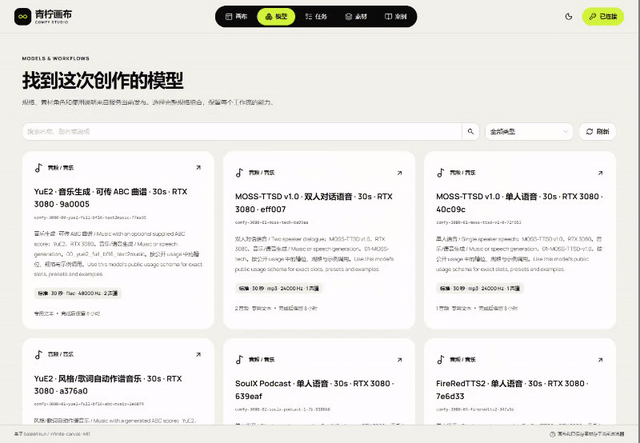
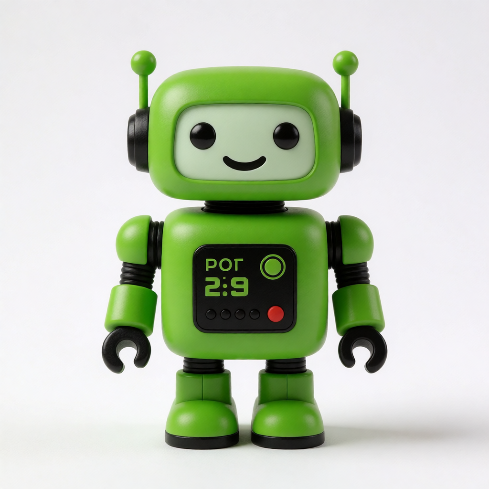
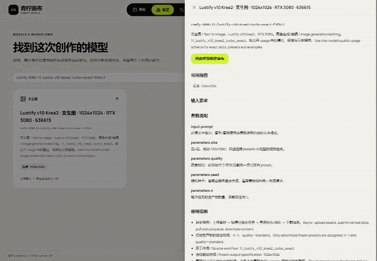

# 39 · 设备恢复与真实生成补充验收

独立网页继续使用 **canvas-20261106.154.1**，原 API 继续使用 **linux-20261104.152.1**。本次处理用户明确授权的设备恢复和真实调用，不新增画布后端，不修改转发、Worker、调度、数据库结构或部署配置。

## 恢复方式与边界

| 编号 | 内容 | 已取得的结果 |
| --- | --- | --- |
| O-01 | 3080 重启前检查 | 确认 ComfyUI 无正在执行或等待的任务；备份原 Worker SQLite journal，完整性检查为 ok；保留原配置和恢复检查点 |
| O-02 | 一次普通 Windows 重启 | 用户授权后执行一次，未使用强制关闭程序选项；ComfyUI 和原 Worker 按原开机配置恢复，没有重新安装或切换版本 |
| O-03 | 原不确定执行收口 | 同一主机开机计数从检查点的 915063156 ms 降至 187296 ms；现有 Worker 用原协议确认重启，旧执行终结一次、重试为 0、原占用解除 |
| O-04 | 3080 原发布工作流 | 原 Admin 渠道探测及 39/39 个既有、已批准、已发布绑定全部验证通过，原发布摘要一致，已恢复接单；另 3 个未批准草稿保持未发布 |
| O-05 | 5070 原发布工作流 | 渠道探测和原 3 个已批准、已发布视频工作流验证全部通过；恢复渠道接单，未重启 5070，也未添加 Windows-MCP |

旧任务 `job_bedd08efb6e24747823f3d5675c437e7` 的结果是 **failed / execution_host_restarted**。这表示原未知执行已安全终止，不表示旧 UniTexture 生成成功。没有手动删除占用、写生产 SQL、伪造停止证据或自动重试。详细证据见[主机恢复回执](research/studio-implementation/host-recovery-155.json)。

[渠道恢复回执](research/studio-implementation/channel-recovery-155.json)保留这 42 个唯一验证操作、发布摘要和渠道恢复结果。3080 校验期间管理会话到期后，仅重新登录并回读原操作 ID；没有重复提交管理操作。这里的验证确认原包、节点及模型依赖，不等于 42 个工作流全部重新执行生成。

## 真实调用与原任务

之前排队到期的 `job_2e8c72346a6d4d22b6e30764fbf4d2a3` 保留原失败、原幂等标记及零执行尝试记录；本次恢复后的验收使用明确区分的新测试意图。后续检查只读取这些测试各自的原任务，不重新生成。

| 编号 | 模式 | 模型 | 本次结果 |
| --- | --- | --- | --- |
| V-01 | 文生图 | comfy-3080-11-lustify-v10-krea2-turbo-exact-f3f6c2 | succeeded；1057371 bytes，实际画布与已存原件校验通过 |
| V-02 | 命名素材参考编辑 | comfy-3080-34-lustify-2d7246 | succeeded；260646 bytes，实际画布与已存原件校验通过 |
| V-03 | Workflow 音乐 | comfy-3080-01-yue2-full-bf16-abc-music-2e68f4 | succeeded；1957834 bytes，实际画布与已存原件校验通过 |
| V-04 | 首帧生视频 | comfy-5070-video-h3-i2v | succeeded；原件 57604 bytes，长度/MIME/SHA 下载校验通过 |
| V-05 | 双参考生视频 | comfy-5070-video-h3-refs | succeeded；原件 81409 bytes，长度/MIME/SHA 下载校验通过 |

V-04 的原任务为 `job_7d3bf31572e54d459bcd449f8a5307c1`，V-05 为 `job_9596f0dee58047bc88d4027e731767fb`。双参考请求使用两张不同的历史验收原件，顺序绑定 `input.references[0]` 和 `[1]`，没有把同一张图片重复冒充多参考；两组视频均使用已发布的 512×288、1.625 秒规格。

历史多参考视频的 `preparation_transport_failure` 记录继续保留。本次成功只证明这里记录的模型、输入及规格，不代表全部 45 个已发布模型、未发布候选或 10～20 台容量均已实测。

## 页面与原件签收

检查实际截图时发现，旧验收脚本仅等待“载入产物”按钮的无障碍名称消失；按钮进入 loading 状态时名称变化，可能使截图早于真实回填。原始回执不改写，也不凭该断言签收本次画布回填。

本轮已补充验证代码：等待按钮文本真正移除，检查对应媒体控件，再从既有日志 v5 只读取得该原任务的已提交 Blob，核对长度、MIME 和 SHA。已成功的真实视频使用原自有浏览器 profile 恢复、查询原 job、载入原件和刷新复查；不重新上传或创建生成任务。新版检查在 Chromium、Firefox 的整组命名输入流程统一复验。

Chromium、Firefox 各 12 次命名输入的新版检查均通过，全部产物都检查实际控件及已提交原件。两个真实视频的原自有 profile 补验也通过：查询原 job、显示视频、核对本机原件，并在本测试明确选择的“记住连接”模式下刷新复查。测试结束已退出连接、移除所保存的测试 Key，并关闭浏览器。第一次原 profile 的模型页导航等待失败保留原回执；补验改用带路由确认的键盘导航，不据此修改产品。

| 证据 | 回执 |
| --- | --- |
| Chromium：12 次明确提交与已存原件 | [新版检查](research/studio-implementation/inputs-154-synthetic-chromium-2026-11-05T23-38-59-807Z.json) |
| Firefox：12 次明确提交与已存原件 | [新版检查](research/studio-implementation/inputs-154-synthetic-firefox-2026-11-05T23-38-59-730Z.json) |
| 两个真实视频：原 profile 取件和刷新 | [已存原件、真实画布与刷新](research/studio-implementation/artifact-recovery-155-chromium-2026-11-05T23-45-21-656Z.json) |
| 原 profile 首次导航失败 | [保留失败](research/studio-implementation/artifact-recovery-155-chromium-2026-11-05T23-41-13-955Z.json) |
| 视频页面 MP4 / GIF | [媒体校验](research/studio-implementation/video-recovery-media-155.json) |

[完整视频取件页面 MP4](media/studio-155/video-recovery.mp4)。保留模型发现之后的完整页面流程，排除输入凭证的连接过程，没有剪掉或加速等待阶段；它展示本次真实视频的原任务取件，不冒充第二次 GPU 生成。

3080 的文生图、命名素材参考编辑、Workflow音乐三类调用均完成真实生成、画布回填、已存原件校验和原profile刷新复验；连同两个视频，共五项通过。业务 Key、Admin 会话、Windows 桌面及原始连接录像只保留在忽略目录，不公开。

## 五类真实原件与最终证据

| 模式 | 原任务 | 原件 |
| --- | --- | --- |
| text-image | `job_b39c759dd6a44a7a8452ba886047aed0` | [image/png · 1057371 bytes](media/studio-155/text-image.png) |
| named-edit | `job_ac6b570b4e6545ceb5dde321197a5559` | [image/png · 260646 bytes](media/studio-155/named-edit.png) |
| named-music | `job_a9f1387833b9478fa00e18b1ea272e2b` | [audio/flac · 1957834 bytes](media/studio-155/named-music.flac) |
| video-first-frame | `job_7d3bf31572e54d459bcd449f8a5307c1` | [video/mp4 · 57604 bytes](media/studio-155/video-first-frame.mp4) |
| video-two-references | `job_9596f0dee58047bc88d4027e731767fb` | [video/mp4 · 81409 bytes](media/studio-155/video-two-references.mp4) |

[完整图像与音频生成MP4](media/studio-155/image-audio-generation.mp4)。此段含模型发现后的完整生成等待与回填；连接凭证输入不公开。它与零生成请求的视频原任务取件录像分开记录。

| 证据 | 回执 |
| --- | --- |
| generation_3080 | [inputs-154-live-chromium-2026-11-05T23-50-35-969Z.json](research/studio-implementation/inputs-154-live-chromium-2026-11-05T23-50-35-969Z.json) |
| artifacts_3080 | [artifact-recovery-155-chromium-2026-11-06T00-02-52-150Z.json](research/studio-implementation/artifact-recovery-155-chromium-2026-11-06T00-02-52-150Z.json) |
| media_3080 | [image-audio-generation-media-155.json](research/studio-implementation/image-audio-generation-media-155.json) |
| real_media | [real-media-155.json](research/studio-implementation/real-media-155.json) |

## 实现与交付说明

画布产品源码、存储契约、青柠明暗样式和已上线静态文件保持 154.1 的冻结内容，复用其 279 单元、类型和生产构建证据。当前改动仅涉及必要的验收工具、文档和证据，不为运维结果重新构建或发布静态应用。

浏览器验收均使用原生独立自有会话，并在 finally 关闭页面、context、浏览器和临时服务；不关闭用户窗口，不调用 Docker、WSL 或虚拟机。源仓库只读边界已[复查通过](research/studio-implementation/independent-api-boundary-a6365cf0838b4192b1b679d6e19d8486.json)。

最终交付核对见[回执](research/studio-implementation/independent-review-155.json)：五类真实原件、75张截图、4份页面MP4/GIF、273个既有文档链接检查通过；公开文件未检出本次凭证，自有浏览器剩余0个。此新增回执链接已另行检查目标存在。
