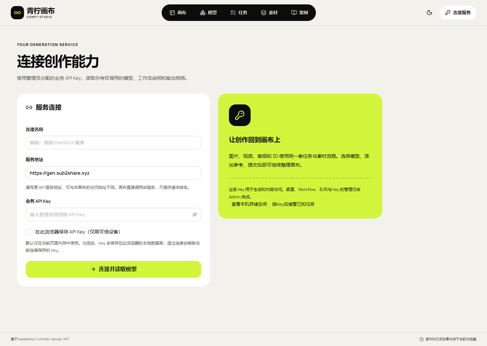
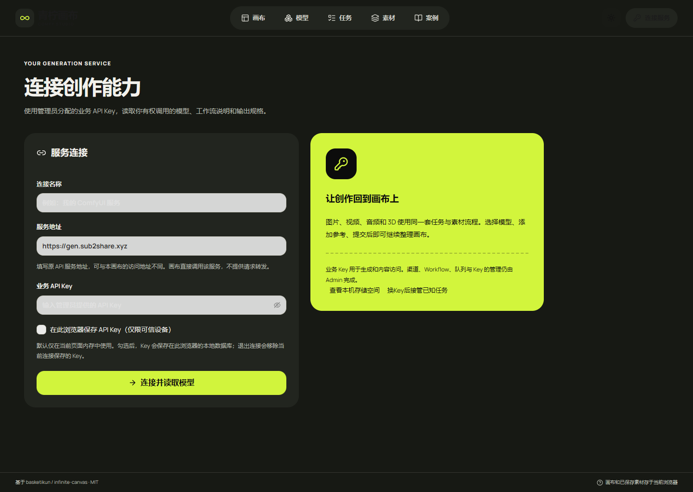
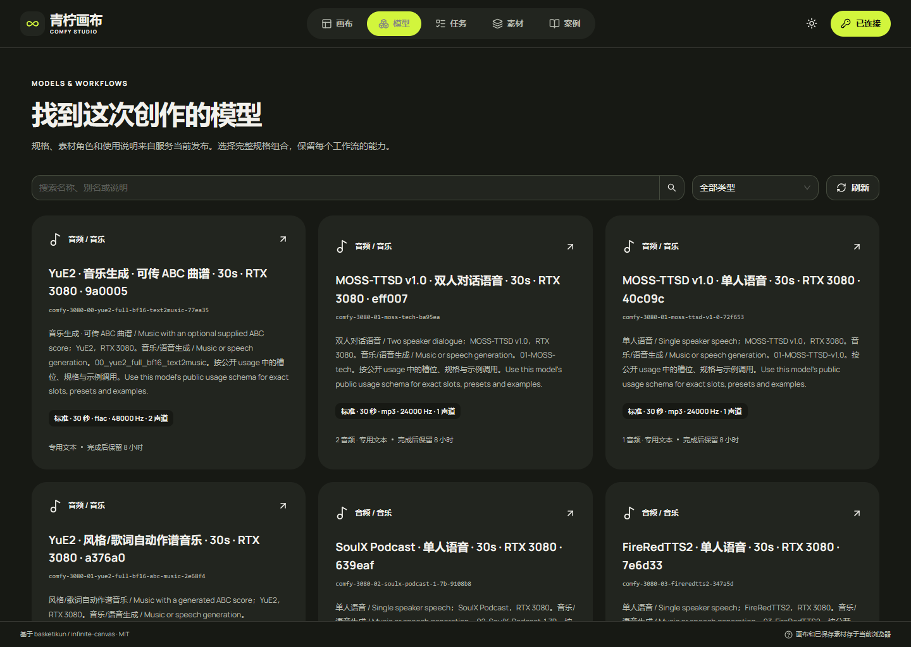

# 默认 HTTPS 接口地址

默认业务 API 调整为 `https://gen.sub2share.xyz`，避免新连接从 HTTPS 页面请求原 HTTP IP 地址。**已上线 `canvas-20261113.156.1`**，本机与线上浏览器均验证通过。

| 项目 | 行为 |
| --- | --- |
| 新建连接 | 默认填入 `https://gen.sub2share.xyz`，明确点击连接后才读取目录 |
| 构建配置 | `VITE_AGGREGATOR_ORIGIN` 非空时显式覆盖；未配置、空白时使用上述 HTTPS 地址 |
| 业务请求 | 继续使用原 `/v1/` 接口及 Bearer Key，`credentials: omit`；不通过画布转发 |
| 已保存连接 | 保留地址和本机任务身份，不自动换源、复制 Key 或重提任务 |
| 旧 HTTP 连接 | 在连接页选择新建连接，填写 HTTPS 地址及业务 Key；旧数据保留 |
| 发布范围 | 只更新独立画布静态文件，当前版本 `canvas-20261113.156.1` |
| 原服务 | 不改 API 代码、Worker、反代、CORS、服务指针或运行配置 |

API 域名使用用户提供的现有 HTTPS 反代；画布继续使用既有静态站点及高位端口。现有明暗主题、模型参数、任务及本机存储契约均保持原行为。本次不提交 GPU 生成请求。

## 验证结果

| 检查 | 结果 |
| --- | --- |
| 单元、类型及生产构建 | 279 项单元通过，类型检查和生产构建通过 |
| 静态包校验 | 14 项发布保护测试通过；124 份静态文件及保留旧资源核对通过 |
| 默认地址 | 未设置构建地址，新连接仍默认使用 HTTPS 域名 |
| 真实 HTTPS 请求 | 本机、线上页面均直接读取到 45 个模型；三个目录接口均使用 HTTPS，无 Cookie |
| 旧连接 | 自有测试配置中的旧地址保留；选择旧连接不会被静默改写 |
| 浅色、深色页面 | 连接页及实际 HTTPS 模型目录截图已更新 |
| 运行资源 | 所有自建页面、浏览器和临时静态服务均已关闭 |
| 原服务 | 静态发布前后 API 指针、配置及进程保持一致；无服务重启 |

[交付记录](research/studio-implementation/independent-delivery-1561.json) · [本机构建](research/studio-implementation/clean-build-2026-11-12T16-15-55-573Z.json) · [本机浏览器](research/studio-implementation/https-default-156-local-2026-11-12T16-21-34-942Z.json) · [线上浏览器](research/studio-implementation/https-default-156-public-2026-11-12T16-23-06-976Z.json)。

原 API 工作区同时存在其他工作的既有改动；只读检查确认本次基线后的 Git HEAD 和已跟踪差异未变。未跟踪证据目录发生变化，原始全状态差异回执保留，详见[比较范围说明](research/studio-implementation/independent-api-boundary-156.json)。本次不覆盖这些文件。

