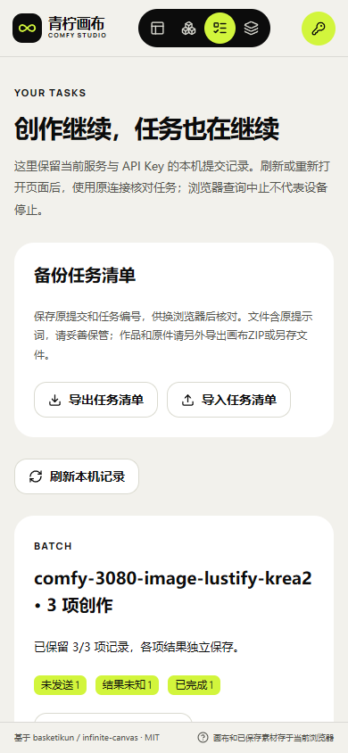
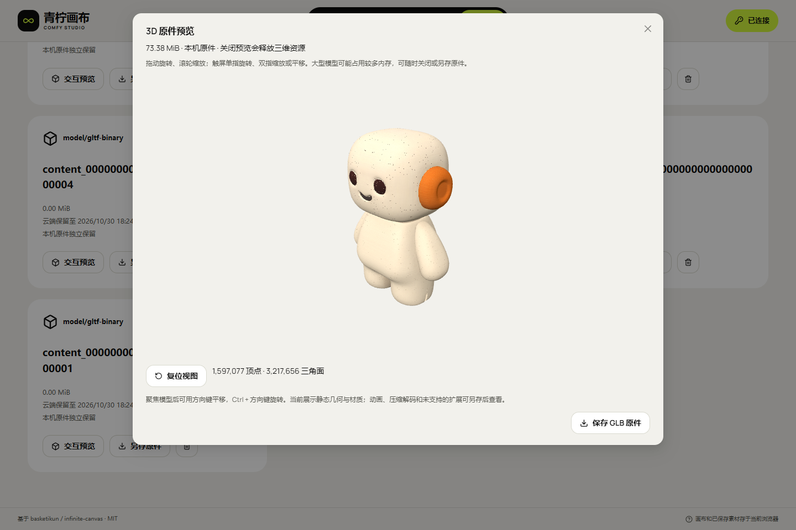
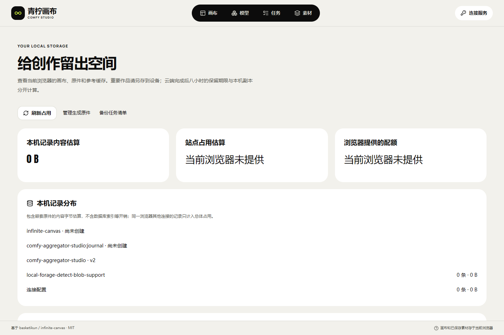
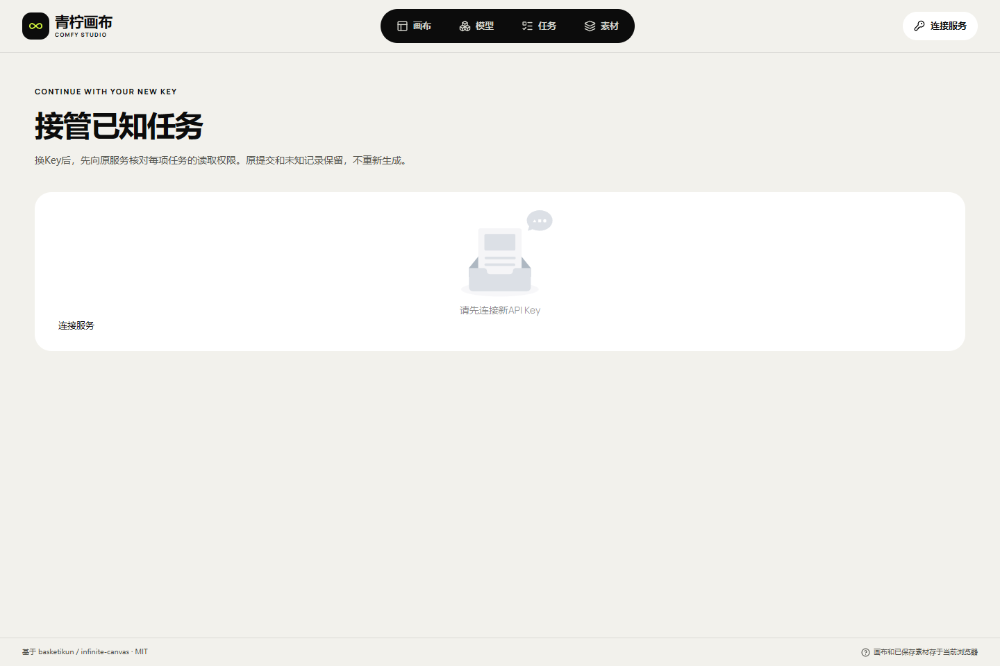

# ComfyUI Creative Canvas

Candidate 137 adds persistent device pools and graphical Admin weights/allocation statistics. Existing models keep first-ready routing; explicit balancing deduplicates physical GPUs and freezes each accepted route. All 38 native focused cases, 1,695 compatibility cases and five browser groups pass; live migration awaits its final receipt. Physical multi-GPU/10–20-device capacity and manual acceptance remain pending-test. [Design and usage](19-持久设备池与融合可用性评估.md).

[中文](USAGE.md) · [Assessment and all 46 requirements](06-融合可行性评估与上线约束.md) · [Current progress](10-开发进度与交付记录.md)

A managed React canvas built from basketikun/infinite-canvas v0.20.0, using the existing ComfyUI Aggregator Proxy. [Studio is live](http://43.165.167.179:39443/studio/) with backend 132.2/static 136.1. Eight actual GPU modes have completed on 3080/5070. The full fault matrix, physical phones and 10–20-node capacity remain separately tracked in [all 46 requirements](10-开发进度与交付记录.md).


[Actual samples, eight call receipts and bilingual gallery](media/studio-131/README.en.md) · [Original-speed UI recording](media/studio-131/studio-focused-tour.mp4) · [Mobile canvas](assets/studio/controls-2026-10-29T22-08-02-756Z/mobile-canvas.png)


## Architecture and usage

Studio handles composition, references, advertised presets and result branches. The existing API retains business Keys, published Workflows, PostgreSQL jobs, quotas, exclusive GPU ownership and authenticated artifacts. Admin retains channel/Workflow/model/Key management and global/per-channel queues. No second generation queue, resident backend or local Agent is added.

1. Open the high-port HTTP endpoint `http://43.165.167.179:39443/studio/`. Connect using the service origin and an administrator-issued business API Key. Do not place the Key in a URL or use an Admin/Worker credential. Temporary validation Keys are not delivery credentials.
2. Read live model usage, Schema, presets, required references, roles and output types. Key-denied specifications are unavailable. Discovery does not guarantee an idle or healthy GPU.
3. Create a canvas and open New Creation. Select a complete published preset and upload the required source/reference images in order. Audio is a Workflow output rather than an assumed speech endpoint. Choose 1–15 independent jobs (default one); each consumes quota separately and the fixed seed is preserved.
4. Before POST, an IndexedDB transaction commits the original body, asset IDs, release digest, identity and idempotency key. Known jobs use GET. If the response is lost, reconcile the original submission; do not change the Key/model/assets to retry.
5. Leave or reload the page and restore with the same connection. Stop Waiting affects browser requests only. Remote cancellation is explicit and the server decides the final state.
6. Verify and load artifacts on demand. Images, video and audio become media nodes; GLB cards and the local library offer an on-demand interactive preview with orbit, zoom, pan and reset. Closing releases rendering resources; saving preserves the original bytes. Continue from an image or export a local canvas ZIP. Unsupported formats remain downloadable.
7. Server History reads existing jobs within the current Key's permissions, including from another browser. Offline ZIP imports create independent local copies and convert task cards to notes; import never generates content.
8. Export the task journal separately from the Tasks page. In another browser, connect the original service/Key, choose the JSON, preview every record, then import records only. Existing records remain unchanged. Imported jobs require an explicit original-job query before their status, artifacts or cancellation can be used; records without job IDs cannot submit generation. A saved identity can export while disconnected. Journals omit media and connection Keys but retain original prompts, so keep the file private.

The seven task types cover text-to-image, image editing, multi-reference images, text-to-video, distinct first-frame/multi-reference video models, Workflow audio and image-to-3D. Static GLB interaction and explicit known-job Key-rotation adoption are implemented. Animation, additional decoders/formats and physical-phone/large-file acceptance remain separately tracked; unknown submissions cannot be resubmitted under a changed Key.

## Retention and identity

ComfyUI output (01), Worker spool (02), cloud artifacts (03) and browser copies (04) are independent. Cloud artifacts expire eight hours after completion. Browser storage is subject to quota and browser/user cleanup; saved originals and exported ZIPs are separate offline copies. Transfer-triggered deletion of 01 is still an upstream service task: deleting ComfyUI history is not proof that files were deleted.

Managed canvas/asset documents and Studio result references share a transaction boundary, including unopened projects and recoverable tasks. Failed saves retain the previous document and show an error; new generation and successful import wait for commits. Export current edits before reloading after a cross-tab conflict. The current v4 browser database preserves v1/v2/v3 records and prevents older clients from ignoring restored-task and new-identity references; static rollback cannot downgrade it. Ordinary image/file garbage collection remains paused; 135.1 adds three-database usage/quota displays and confirmed, unreferenced upload-cache cleanup. Uncertain uploads and physical-phone quota recovery remain pending. [Storage design](12-本机引用事务与保存失败恢复.md) · [131.7 recovery MP4](media/studio-131/studio-storage-recovery-verified.mp4) · [GIF](media/studio-131/studio-storage-recovery-verified.gif), recorded with a synthetic API and injected quota failure, not actual disk exhaustion or GPU execution.

Task journals use an independent format version and SHA-256. Import previews the file, then adds records in one transaction; any conflict or quota error aborts the entire batch. The checksum is not a signature: archived status/revisions require an authenticated server query and do not grant permissions. Export canvas ZIPs/originals separately; this is not WebDAV or cloud sync. [Journal design and limits](13-任务清单备份与只读恢复.md) · [Final demonstration MP4](media/studio-131/studio-task-backup-verified.mp4) · [GIF](media/studio-131/studio-task-backup-verified.gif).

Business fetch uses a fixed origin, Bearer authorization, credentials: omit and rejected redirects. Admin sessions and Worker credentials remain separate. Managed mode rejects arbitrary scripts, plugins and automatic Agent execution. Exports remove credentials by default. Client-side partitioning is not a multi-user security sandbox on a shared computer. Corrupt/unknown journal versions are preserved instead of silently erased.

## Source and native build

The active workspace is `无限画布/`. Canonical frontend: `infinite-canvas/web/`; backend feature checkout: `aggregator-service/`. Reviewed frontend source/locks are mirrored to `aggregator-service/app/apps/studio_web/` and documentation/evidence to its `docs/studio/`. Private tools, databases and credentials stay in ignored `.local/`. The original sibling aggregator checkout is read-only.

Use native Node.js 22.14.0 / npm 10.9.2:

```powershell
cd infinite-canvas/web
npm ci
$env:VITE_STUDIO_MODE='managed'
$env:VITE_BASE='/studio/'
npm run build
```

Serve dist at `/studio/` with a correct SPA fallback, MIME types and Worker path. Main-document strict CSP and the isolated Schema Worker's compilation policy are separate. Keep `/admin/` and `/v1/` on the existing service. No Docker, WSL or VM is used. The user manages domain reverse proxying; HTTP on the existing high port and any-origin CORS remain supported with business authentication.

All 46 requirements remain tracked. Current evidence covers 179 frontend units/type/build and 171 native-browser groups, including 31 access groups. The isolated same-lock build matches all 106 files. All 555 backend runtime sources match frozen 132.2 Git; prior 112/1,486 backend results are reused, not rerun. Six public storage/access checks, three v3→v4 preservation/restart checks and health/CORS pass without API/Worker/Edge restart. [Current evidence](research/studio-implementation/task-access-validation-notes-1361.json) preserves failures and corrections. Five actual rotation groups pass: one 720×1080 image completed from one submission, and the rotated credential downloaded its 747,994-byte original with an identical SHA. Old credentials return 401, an unrelated logical Key returns 404, and removed cancellation permission returns 403. Five dedicated validation Keys are disabled and six credentials return 401; existing user Keys are unchanged. This single sample took 1,483 seconds (24m43s), with queue/loading/execution not separated; latency and throughput remain unaccepted. Historical eight-mode evidence means one UI and seven API submissions; the 48ms audio-meter difference remains open.

Actual backend/static rollback preserves existing jobs/content. A new 5070 ten-minute idle cycle completed with both CPU barriers. Builds, browser tests, GPU media, phones and fleet capacity remain separate evidence. Non-crash test-database settings do not change production durability or prove power-loss recovery.

## Attribution

Upstream [basketikun/infinite-canvas](https://github.com/basketikun/infinite-canvas), MIT, commit `9cd3deacbcc598361807afc16c059a80dd18b6f9`. Preserve its license and author attribution. The managed UI uses the user's required [04 · Lime style](https://html.cafe/x5b381ea1); original CSS, font declarations, hashes and font licenses are preserved in web/src/styles/reference/ 和 web/public/fonts/, with separate adaptations.

## Read-only submission recovery (132.2 deployed)

After a lost response or journal import, `POST /v1/jobs/lookup` matches the original business Key, frozen body, idempotency key and release digest to restore the original job ID. It requires only `jobs:read` and never generates, uploads or charges again. A not-observed result stays unknown; older services fail clearly without falling back to creation. An IDB write transaction also claims the first send across pages.

[Operation and development contract](14-原提交只读核对与恢复.md) · [Original-speed MP4](media/studio-131/studio-submission-lookup.mp4) · [390px view](assets/studio/submission-lookup-2026-10-30T00-27-20-776Z/mobile-original-job-restored.png). This recording uses the production build with synthetic HTTP, not a GPU run or physical phone.


## Independent batches (static133.1 deployed)

Choose 1–15 jobs, default one. All members commit in one strict local transaction before sequential calls to the existing n=1 API. Each owns an independent job, idempotency key and canvas branch, using the same inputs/preset/references/fixed seed. An error or unknown response stops that invocation. Explicitly continue only native never-sent members; accepted, terminal, unknown and imported records are skipped. Unknown submissions use read-only lookup, and failed members never rerun successful siblings.

Batch archives use v2; ordinary archives remain v1. Importing any member, even prepared, never authorizes generation. At 133.1 the browser DB stayed v3; current 136.1 uses v4. Loading/failed task cards expose original-job query controls. [Contract and limits](15-批量创作与部分失败恢复.md) · [Original-speed MP4](media/studio-131/studio-batch.mp4) · [GIF](media/studio-131/studio-batch.gif). The 15 batch groups use production UI with synthetic HTTP; real GPU batch faults, phones and fleet capacity remain open.



## Interactive GLB preview (static 134.1)

Choose Interactive Preview on a model card or in the local library. Drag to orbit, scroll to zoom, use single/two-finger touch gestures, reset the view or save the unchanged original. The component loads on demand and releases WebGL, textures, bitmaps and listeners on close. Service originals retain their original-Key boundary; offline snapshot copies can preview independently.

Three.js 0.186.1 / MIT is bundled locally. External resources and unsupported required extensions/decoders are refused. Corrupt files, missing components and unsupported browsers show a reason while preserving original saving. An existing real 76.94 MB ComfyUI GLB passes rendering and original-hash checks. Separate public HTTP checks cover embedded textures, reload and cleanup with no new GPU generation, business Key or database migration. Animation and physical-phone peak memory remain open.

[Design and 14 bound receipts](16-GLB交互预览与资源释放.md) · [Original-speed MP4](media/studio-131/studio-model3d.mp4) · [GIF](media/studio-131/studio-model3d.gif) · [Public screenshot](assets/studio/public-model3d-2026-10-30T02-27-32-469Z/public-offline-textured-glb.png)



## Local storage and reference cache (135.1 deployed)

Open [Local storage](http://43.165.167.179:39443/studio/storage) from Connection or Assets. It reads the existing canvas, journal and connection databases, separating estimated record payloads from browser-provided site usage/quota. Unavailable site estimates on ordinary HTTP remain unknown; they are not free-disk measurements.

The reference list belongs to the current service/Key fingerprint. Only acknowledged uploads with matching hashes/lengths and no original-task references can be removed after individual confirmation. One strict transaction rechecks current references, identity and the selected record snapshot. Every task stage and source/mask/reference role protects its cache. Changed records, new references, identity changes and aborted transactions preserve data; late upload responses cannot recreate a removed cache. This removes a local upload record without deleting remote tasks/assets or generated originals.

Ordinary image/file garbage collection, uncertain-upload disposition and physical-phone quota recovery remain pending. In the 135.1 increment, all 169 units and 140 native-browser groups pass, including 28 cache groups with real two-page transactions and synthetic upload-response races. Native empty-directory installation of the new lock passed; after retaining `.gitignore`, an isolated final-source build matches all 104 production assets exactly. The mirror contains 262 source/configuration files. Four public storage checks, three preservation/restart checks and health/CORS pass. API, Worker and Edge were not restarted; no new GPU job or business Key was created. Full acceptance remains HOLD.

[Usage and implementation constraints](17-本机空间与参考缓存清理.md) · [Original-speed MP4](media/studio-131/studio-upload-cache.mp4) · [GIF](media/studio-131/studio-upload-cache.gif) · [Evidence](research/studio-implementation/storage-validation-notes-1351.json)



The [390px confirmation](assets/studio/upload-cache-2026-10-30T03-06-13-206Z/mobile-cache-confirmation.png) uses production UI and a synthetic API; the public empty-identity page is checked separately. Neither means GPU execution or a physical phone.

## Continue original tasks after Key rotation (136.1)

Rotate the original business Key in Admin, connect with its new credential, then open [Known-task access](http://43.165.167.179:39443/studio/task-access) and confirm each job individually. An association is committed only after the server returns the matching original job under the new credential. The original identity, prompt, idempotency key, release digest and canvas node remain intact. A separate logical Key does not inherit the old jobs; cancellation still requires server permission. Unknown submissions without a job ID cannot be reconciled or submitted under a changed Key.

Connecting preserves the old profile metadata and removes its saved plaintext credential. Original-identity journal exports omit Keys, access proofs, canvas data and media. Restore artwork ZIP and journal JSON separately in another browser, then recheck each known job. Backup SHA proves integrity, not authorization or the original server prompt. New downloads belong to the new fingerprint; old caches remain. Removing an association does not cancel a job or delete files, and the original eight-hour cloud expiry remains.

The browser journal advances to v4 while preserving v1/v2/v3 records. Old v3 clients must reload; static rollback cannot downgrade local data. All 179 units/type/build and 171 native-browser groups pass, including 31 new access groups. The isolated same-lock build matches all 106 production files; the delivery mirror contains 265 source/configuration files. Six public storage/access checks, three actual v3→v4 preservation/restart checks and health/CORS pass without restarting API/Worker/Edge. Five actual rotation groups pass: one 720×1080 image completed from one submission, and the rotated credential downloaded its 747,994-byte original with an identical SHA. Old credentials return 401, an unrelated logical Key returns 404, and removed cancellation permission returns 403. Five dedicated validation Keys are disabled and six credentials return 401; existing user Keys are unchanged. This single sample took 1,483 seconds (24m43s), with queue/loading/execution not separated; latency and throughput remain unaccepted. Full faults, physical phones and fleet capacity remain HOLD.

[Contract](18-Key轮换与已知任务接管.md) · [Evidence index](research/studio-implementation/task-access-validation-notes-1361.json) · [Original-speed MP4](media/studio-131/studio-task-access.mp4) · [GIF](media/studio-131/studio-task-access.gif) · [Hashes / full decode](media/studio-131/studio-task-access-manifest.json). The UI recording uses a synthetic API and native IndexedDB; actual server permission evidence is separate.



[Association](assets/studio/task-access-2026-10-30T04-05-17-889Z/desktop-associated.png) · [Original canvas](assets/studio/task-access-2026-10-30T04-05-17-889Z/desktop-original-canvas.png) · [390px confirmation](assets/studio/task-access-2026-10-30T04-05-17-889Z/mobile-confirmation.png) · [Old-identity backup preview](assets/studio/task-access-2026-10-30T04-05-17-889Z/mobile-original-backup-preview.png). These operation screenshots show the tested production build with synthetic endpoints, not a physical phone or GPU-generation recording.

[Actual new image](media/studio-131/key-rotation-1361.png) · [Request, delivery and elapsed time](research/studio-implementation/key-rotation-delivery-1361.json) · [Validation-Key closure](research/studio-implementation/validation-key-closure-1361.json).
