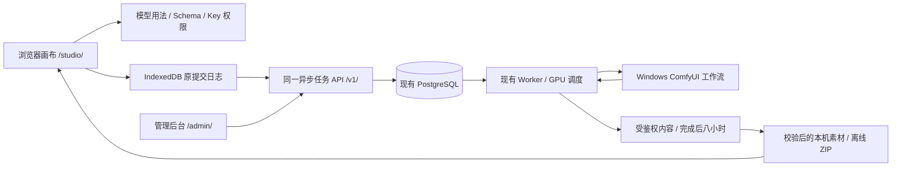

# ComfyUI 无限创作画布

[English](USAGE.en.md) · [完整评估与 46 项范围](06-融合可行性评估与上线约束.md) · [最新进度](10-开发进度与交付记录.md)

以 basketikun/infinite-canvas v0.20.0 为创作前端，复用已有 ComfyUI 中转服务。正式适配已部署至 [公网画布](http://43.165.167.179:39443/studio/)，后端132.2、静态134.1。3080/5070已完成八种真实媒体模式；完整故障矩阵、物理手机和10～20台容量仍待验收，最终状态以[完整进度表](10-开发进度与交付记录.md)为准。


[真实样片、八种调用回执与双语图集](media/studio-131/README.md) · [原速界面演示 MP4](media/studio-131/studio-focused-tour.mp4) · [手机画布](assets/studio/controls-2026-10-29T22-08-02-756Z/mobile-canvas.png)


画布负责构图、参考素材、规格选择和结果分支；中转负责业务 Key、模型发布、持久队列、配额、GPU 排他和文件交付；Admin 继续管理 Windows/ComfyUI 渠道、模型、Workflow、Key 和全局/分渠道队列。没有第二套生成队列，不增加常驻生成后端或本地 Agent。



## 使用流程

1. 打开入口 `http://43.165.167.179:39443/studio/`，在连接页填写同源服务地址及管理员提供的**业务 API Key**。地址不带 `/admin/`；Key 不放 URL。使用原 Admin 中创建或授权的业务 Key；临时验收 Key 不作交付凭证。
2. 读取模型目录，在说明中查看完整规格、参考槽位、角色、参数和输出格式。Key 未授权的规格不能提交；目录存在不等于设备当前空闲。
3. 新建画布，点击“新建创作”。选择已发布模型和完整 preset；单图/3D 上传源图，多参考按顺序填满槽位。音频是 Workflow 产物，非 TTS 接口。任务数量默认1项，可沿用画布范围选择1～15项；每项独立计入配额，固定种子不会暗改。
4. 提交前原正文、素材 ID、发布摘要及幂等键先写入事务日志。收到 ID 后只查询原任务；响应丢失时在任务页“核对原提交”，不能换 Key/模型/图片盲目重提。
5. 可以离开/刷新画布，使用原服务和 Key 恢复。停止本页等待只停止查询；远程取消单独请求，以服务端终态为准。
6. 成功后按需校验并载入原件，成为图片、视频、音频节点或 GLB 模型卡。模型卡和素材库均可“交互预览”，旋转、缩放、平移和复位；关闭释放三维资源，另存保留原件。可继续引用图片或导出离线画布 ZIP。不支持的格式仍可保存原件。
7. 任务页还可读取当前 Key 有权访问的服务端历史；换浏览器只读原任务。导入离线 ZIP 新建本机副本，任务卡变为说明，不会触发重新生成。
8. 在任务页“导出任务清单”，单独备份原提交和任务编号。换浏览器后连接原服务及原Key，导入JSON，预览后“仅导入记录”；已有记录不覆盖。导入不自动查询，点击“查询原任务”后才采用服务端状态并开放产物/取消；无任务ID的备份禁止补发生成。断开连接后仍可为已保存身份离线导出。清单不含媒体原件和连接Key，提示词按原文保留，请妥善保管。

七种任务分别是文生图、单图编辑、多参考生图、文生视频、首帧/多参考视频、Workflow 音频与图片生 3D。首帧和多参考是不同发布模型；GLB 已支持静态交互预览，动画、额外解码器及其他三维格式另行适配。显式 Key 轮换接管、真机手机和大文件签收仍见全部待办。

## 素材、权限和恢复

ComfyUI 原输出 01、Worker 暂存 02、云端 03 和浏览器 04 是不同副本。云端完成后八小时到期；本机副本由浏览器存储和用户管理，可能被配额或清理影响，另存原件/ZIP 才构成独立离线副本。01 移交到 02 后删除仍是中转服务独立待开发项，不能把删除历史当删除文件。

托管画布、素材文档和 Studio 原件引用共用事务，保护未打开的项目及可恢复任务。保存失败会提示并保留旧版本，生成和导入成功提示须等待提交；跨页冲突请先导出当前编辑，再重新载入。当前本机数据库v3保留v1/v2旧记录，阻止旧界面忽略备份恢复保护；静态回退不能降级浏览器数据。普通 image/file 自动回收暂缓，上传缓存清理与完整配额界面仍待实现。[保存与引用方案](12-本机引用事务与保存失败恢复.md) · [131.7保存恢复 MP4](media/studio-131/studio-storage-recovery-verified.mp4) · [GIF](media/studio-131/studio-storage-recovery-verified.gif)（本机合成接口/配额故障注入，非真实磁盘耗尽或 GPU）。

任务清单采用独立版本和SHA-256校验；导入先预览，最终单个事务处理全部记录，冲突或空间不足整批中止。SHA不是签名，备份中的状态和版本号须先经原服务查询确认，不能借备份自报权限。它与作品ZIP分别使用，不是WebDAV或云同步。[任务清单方案与限制](13-任务清单备份与只读恢复.md) · [最终操作MP4](media/studio-131/studio-task-backup-verified.mp4) · [GIF](media/studio-131/studio-task-backup-verified.gif)。

连接按源站与 Key 指纹分区，业务 fetch 使用 Bearer 且不携带管理 Cookie。管理会话和 Worker 凭证独立。托管模式从执行入口拒绝任意脚本、插件和自动 Agent；默认配置/画布导出剥离凭证。客户端分区不是共享电脑上的多人安全沙箱。自有日志损坏或未知版本时保留原记录，不清空数据冒充恢复。

## 目录与原生开发

```text
无限画布/
├─ infinite-canvas/web/       正式 React/Vite 工作副本
├─ aggregator-service/       中转独立功能分支；授权远端的交付仓库
│  ├─ app/apps/studio_web/    审阅后的画布源码、锁和上游来源镜像
│  └─ docs/studio/            对应方案和公开证据镜像
├─ docs/                     评估、开发契约、46 项状态与证据
└─ .local/                   忽略的本机工具、测试数据库和私有凭证
```

所有后续工作在本目录；相邻旧中转仓库只读。没有调用 Docker、WSL 或虚拟机。服务仍使用高位普通 HTTP，用户自行反向代理，CORS 允许任意来源而业务鉴权继续生效。

原生前端使用 Node.js 22.14.0 / npm 10.9.2 与提交的 package-lock.json。执行：

```powershell
Set-Location 'E:\dev\sandbox\无限画布\infinite-canvas\web'
npm ci
$env:VITE_STUDIO_MODE='managed'
$env:VITE_BASE='/studio/'
npm run build
```

将 `dist/` 作为 `/studio/` 的静态内容，SPA 深链回退到该目录 index.html。JSON Schema 校验在独立 Worker 执行；主文档严格 CSP 与 Worker 的局部编译权限分开，参见部署记录。Admin 和 `/v1/` 仍由原服务处理。发布必须验证 MIME、Worker 路径、HTTP、健康、幂等和回滚，不覆盖服务器其他应用。

## 方案与验证

- [职责、部署、移动和保留](04-本地源码与中转服务融合方案.md)、[接口映射](05-中转服务接口映射与开发验收清单.md)
- [完整评估与 F-01～F-46](06-融合可行性评估与上线约束.md)、[提交与故障契约](07-融合实现契约与故障恢复.md)
- [历史基线与 G-01～G-27 门禁](08-可用性验证与发布验收.md)、[模型样本](09-模型适配样本与用户流程.md)
- [最新实现、失败保留、部署与全部剩余事项](10-开发进度与交付记录.md)、[文档索引](USAGE.md)

当前前端159单元、类型/构建及112组原生浏览器检查通过，包含18界面、22存储、25任务清单、15只读恢复、15批次和17三维专项。555个后端运行源码与已发132.2冻结Git相同，沿用原112专项与1,486兼容结果；生成Admin类型另有类型/构建证据。公网三维四项、数据保留/重启三项和四入口健康通过；[当前证据索引](research/studio-implementation/model3d-validation-notes-1341.json)保留旧失败与修正。本轮复用已生成GLB，不新增GPU生成或Key。历史八模式是一项UI加七项API提交，并非十一别名重测。音频文件/浏览器30,000ms与服务解码进度29,952ms差48ms，处于现有100ms容差内，精确计量另行跟踪。

原生后端与静态新旧包回滚已经执行，任务/内容未丢失。5070新十分钟空闲回收完成并通过双屏障。构建、浏览器、真实GPU、物理手机和容量分别记录；隔离测试数据库的非崩溃配置不改变生产持久性，也不作为断电恢复证明。

## 来源和许可

上游 [basketikun/infinite-canvas](https://github.com/basketikun/infinite-canvas) 固定提交 `9cd3deacbcc598361807afc16c059a80dd18b6f9`，MIT 许可与作者标识保留。全面使用 [04·青柠原始样式](https://html.cafe/x5b381ea1)；原始 CSS、字体声明、摘要和字体许可证在 web/src/styles/reference/ 和 web/public/fonts/。适配层独立维护，不能把青柠来源声明替换为自创主题。

## 原提交只读核对（132.2 已部署）

响应丢失或任务清单恢复后，可以通过原业务 Key、原请求、原幂等键和原发布摘要，使用 `POST /v1/jobs/lookup` 找回原任务 ID。只要求 `jobs:read`；不会再次生成、上传或计费。未查到继续保留未知状态，旧服务未声明支持时明确提示，不回退生成。两个页面也通过本机写事务共享首次发送占用。

[完整操作与开发约束](14-原提交只读核对与恢复.md) · [原速 MP4](media/studio-131/studio-submission-lookup.mp4) · [390px 页面](assets/studio/submission-lookup-2026-10-30T00-27-20-776Z/mobile-original-job-restored.png)。以下为生产构建配合合成 API 的恢复演示，无 GPU 或物理手机实测含义。


## 批量创作（静态133.1已部署）

数量默认1项，沿用原画布1～15项。所有成员先在一个严格本机事务中保存，再逐项调用现有n=1 API；每项拥有独立任务、幂等键和画布分支。输入、规格、素材和固定种子保持一致。任一提交失败或响应未知会停止本次发送，后续项保持未发送；任务页可明确继续，仅提交本机从未发送项，跳过已受理、终态、未知及导入记录。未知项仍只读核对原提交，失败不会重跑成功项。

批次任务清单使用v2，普通清单仍v1；导入包括prepared项均不授权补发生成，浏览器数据库保持v3。任务卡在生成中/失败时也显示原任务查询入口。[具体契约与边界](15-批量创作与部分失败恢复.md) · [原速MP4](media/studio-131/studio-batch.mp4) · [GIF](media/studio-131/studio-batch.gif)。本轮15组批次专项来自生产构建与合成HTTP，真实GPU批次故障、手机和机群容量仍待验收。


## GLB 交互预览（静态134.1）

在模型卡或本机素材库点击“交互预览”，鼠标拖动旋转、滚轮缩放，触屏使用单指/双指操作；可随时复位、关闭或保存GLB原件。组件按需加载，关闭释放WebGL、贴图/位图及监听。原服务结果继续受原Key隔离；含原件的离线副本可独立预览。

Three.js 0.186.1 / MIT随项目本地打包。预览阻止外链及未支持的必要扩展/压缩解码；文件损坏、组件缺失或浏览器不支持时说明原因并保留原件下载。已有76.94MB真实ComfyUI GLB渲染和摘要通过；公网另外验证内嵌贴图、刷新及释放，无新GPU生成、业务Key或数据库迁移。动画及手机峰值内存仍待验收。

[完整方案与14份回执](16-GLB交互预览与资源释放.md) · [原速MP4](media/studio-131/studio-model3d.mp4) · [GIF](media/studio-131/studio-model3d.gif) · [公网截图](assets/studio/public-model3d-2026-10-30T02-27-32-469Z/public-offline-textured-glb.png)


