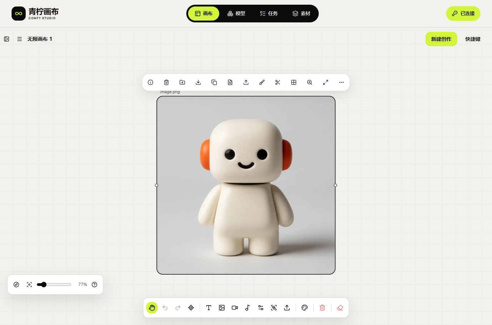

# 131 · 实际画布、样片与调用记录

[English](README.en.md) · [公网画布](http://43.165.167.179:39443/studio/) · [完整46项进度](../../10-开发进度与交付记录.md) · [使用与运维](../../11-线上使用与原生发布运维.md)

当前静态131.9、后端131.1。下表的GPU任务与原画布演示在131.6完成：文生图由线上画布提交，其他七项由原生客户端按已发布用法调用同一API。随后用真实浏览器从服务端历史载入素材库，验证图片解码、音视频播放以及全部八份原件下载的字节数和SHA。GLB只有下载卡，没有交互式三维预览。

131.9补[任务清单恢复MP4](studio-task-backup-verified.mp4)、[GIF](studio-task-backup-verified.gif)及[来源/摘要](studio-task-backup-verified-manifest.json)：实际生产构建UI导出、预览/确认、主动查询原任务、损坏文件/配额失败和离线导出；25组检查通过，业务写请求为零。使用合成API和390px模拟视口，不计为GPU或物理手机。截图：[导入预览](../../assets/studio/task-backup-2026-10-29T23-35-14-126Z/desktop-import-preview.png)、[手机预览](../../assets/studio/task-backup-2026-10-29T23-35-14-126Z/mobile-import-preview.png)、[手机待核对](../../assets/studio/task-backup-2026-10-29T23-35-14-126Z/mobile-restored-records.png)、[原任务确认](../../assets/studio/task-backup-2026-10-29T23-35-14-126Z/desktop-known-job-queried.png)、[损坏文件](../../assets/studio/task-backup-2026-10-29T23-35-14-126Z/desktop-invalid-backup.png)、[配额失败](../../assets/studio/task-backup-2026-10-29T23-35-14-126Z/desktop-import-quota-failure.png)。任务清单与作品ZIP分别备份；[机制和限制](../../13-任务清单备份与只读恢复.md)。早期studio-task-backup文件为131.8中间证据，当前演示使用verified版本。

131.7另补[保存失败与重试MP4](studio-storage-recovery-verified.mp4)、[GIF](studio-storage-recovery-verified.gif)及[来源/摘要](studio-storage-recovery-verified-manifest.json)。这是本机生产构建配合合成API、配额故障注入的真实界面录制，包含手机视口与跨页冲突；不是真实磁盘耗尽、GPU生成或物理手机。截图见[390px未保存提示](../../assets/studio/storage-2026-10-29T23-00-07-628Z/mobile-save-failed.png)、[重试后](../../assets/studio/storage-2026-10-29T23-00-07-628Z/mobile-saved-after-retry.png)、[跨页冲突](../../assets/studio/storage-2026-10-29T23-00-07-628Z/desktop-cross-tab-conflict.png)。

| 编号 | 模式与公开模型 | 实际原件 | 可审阅样片 |
| --- | --- | --- | --- |
| M-01 | 文生图 · comfy-3080-image-lustify-krea2 | 1024×1024 PNG；965,536字节 | [图片](image.png) |
| M-02 | 单图编辑 · comfy-3080-image-edit-wai | 720×1080 PNG；722,985字节 | [图片](edit.png) |
| M-03 | 双参考生图 · comfy-3080-image-refs-wai | 720×1080 PNG；1,001,038字节 | [图片](references-image.png) |
| M-04 | 文生视频 · comfy-5070-video-h3 | 512×288、1.625秒MP4；59,009字节 | [视频](text-video.mp4) |
| M-05 | 首帧视频 · comfy-5070-video-h3-i2v | 512×288、1.625秒MP4；60,266字节 | [视频](first-frame-video.mp4) |
| M-06 | 双参考视频 · comfy-5070-video-h3-refs | 两个独立槽位；512×288、1.625秒MP4；66,156字节 | [视频](references-video.mp4) |
| M-07 | Workflow音频 · comfy-3080-music-yue2 | 48kHz双声道FLAC；文件/浏览器30秒；2,233,080字节 | [音频](audio.flac) |
| M-08 | 图片生3D · comfy-3080-3d-trellis2 | 76,942,864字节GLB；1,597,077顶点、3,217,656三角形、无纹理 | [下载卡截图](../../assets/studio/library-2026-10-29T22-17-34-870Z/glb-delivery-card.png)，完整摘要见清单 |

公开样片移除了嵌入的Workflow/容器元数据，所以样片字节数和SHA与下载原件不同。PNG像素未改；音视频仅复制码流，没有重新编码。原件摘要与样片摘要分别保存在[媒体清单](media-manifest.json)，不可混用。较大的GLB留在忽略的本机目录，不加入Git；清单、几何探测与浏览器完整下载回执仍公开。素材为本次自有测试机器人及音乐，无客户素材。

音频服务元数据29,952ms，独立文件探测和浏览器30,000ms，相差48ms，位于既有音频验证器100ms容差内。该差异原样记录，精确毫秒计量仍需完善。音乐使用器乐风格提示词；冻结Workflow可能自带歌词，不承诺提示词覆盖其歌词，也不是TTS接口。

## 页面与录像

[原速MP4](studio-focused-tour.mp4) · [录像清单](studio-focused-tour-manifest.json) · [手机画布](../../assets/studio/controls-2026-10-29T22-08-02-756Z/mobile-canvas.png) · [横屏画布](../../assets/studio/controls-2026-10-29T22-08-02-756Z/landscape-canvas.png) · [双参考表单](../../assets/studio/controls-2026-10-29T22-08-02-756Z/mobile-multi-reference-composer.png) · [素材库](../../assets/studio/library-2026-10-29T22-17-34-870Z/desktop-library.png) · [手机素材库](../../assets/studio/library-2026-10-29T22-17-34-870Z/mobile-library.png)

录像是实际UI操作，未包含Key配置页面，不是完整GPU生成等待录像。手机图来自390px Chromium模拟视口，不代表Android/iOS真机签收。早期studio-tour文件属于旧静态包回执，当前展示使用studio-focused-tour。

## 调用与验证

[八种实际请求/终态响应](api-calls.json)保留正文、发布摘要、原正文SHA、任务ID和内容元数据；鉴权值移除，幂等键只留SHA。这是可审阅调用记录，素材ID与验收Key会过期，不能直接当作永久可执行请求。使用自己的业务Key读取实时/models、/capabilities与用法，上传自己的素材，再按该发布的Schema/preset/slots构造新请求。响应未知时核对原请求，不能换素材或Key盲目重提。

[实际生成](../../research/studio-implementation/live-media-131.json) · [浏览器9项检查](../../research/studio-implementation/live-library-2026-10-29T22-17-34-870Z.json) · [当前界面4组检查](../../research/studio-implementation/live-controls-2026-10-29T22-08-02-756Z.json) · [实际API/临时Key停用](../../research/studio-implementation/live-api-131.json) · [静态升级与浏览器重启](../../research/studio-implementation/live-upgrade-2026-10-29T21-30-26-230Z.json)

浏览器读取八份原件后的进程私有字节采样约347→651MiB，JS堆约8.2→17.1MiB；包括76.94MB GLB。该采样不是峰值、泄漏测试或手机容量认证，工作集相加可能重复计算共享页。所有自建浏览器在finally关闭；两把临时业务Key已停用且返回401。

云端八份产物均在任务完成后28,800秒到期，本机原件与另存文件独立保留。本次通过不覆盖全部11别名、全部格式/故障矩阵、01移交即删、物理手机、全局公平池或10～20台容量；完整剩余项保留F编号。
